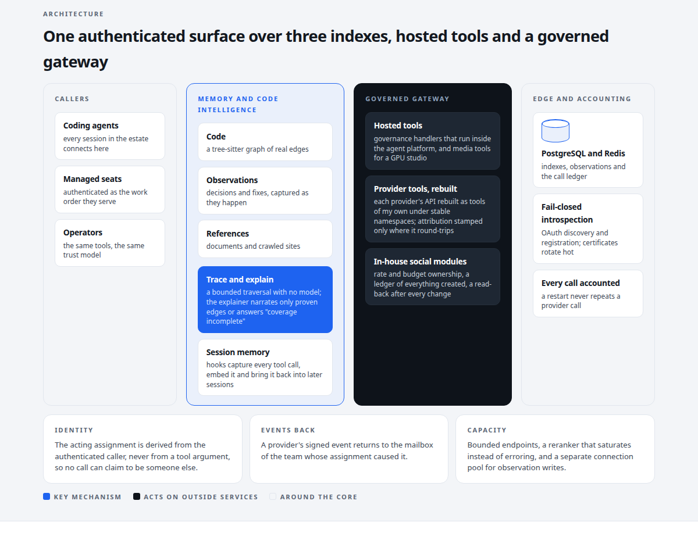
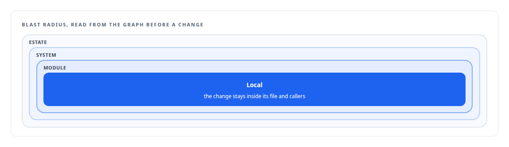
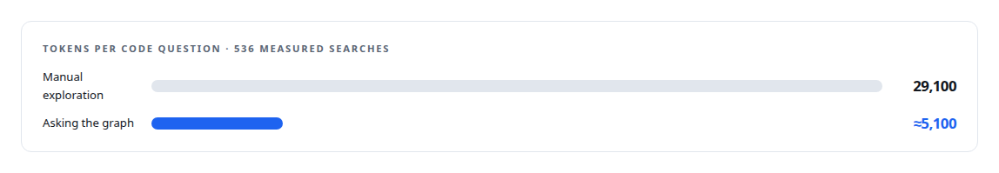

# FAFOHive

**The MCP hub every agent in my estate connects to: memory and code intelligence, hosted tools, and a governed tool gateway**

Canonical: https://coreyjames.ai/systems/fafohive/  
Author: Corey James · Published: 2026-10-28 · Kind: system  
Technologies: [Admission control and rate limiting](https://github.com/coreyjames-ai/portfolio/tree/main/technologies/admission-control-and-rate-limiting) · [Agent tool qualification testing](https://github.com/coreyjames-ai/portfolio/tree/main/technologies/agent-tool-qualification-testing) · [Applied cryptography](https://github.com/coreyjames-ai/portfolio/tree/main/technologies/applied-cryptography) · [Axum](https://github.com/coreyjames-ai/portfolio/tree/main/technologies/axum) · [Budget enforcement and cost governance](https://github.com/coreyjames-ai/portfolio/tree/main/technologies/budget-enforcement-and-cost-governance) · [Business-provider APIs rebuilt as governed agent tools](https://github.com/coreyjames-ai/portfolio/tree/main/technologies/business-provider-apis-rebuilt-as-governed-agent-tools) · [Capacity engineering, backpressure and load testing](https://github.com/coreyjames-ai/portfolio/tree/main/technologies/capacity-engineering-backpressure-and-load-testing) · [Chrome extensions (Manifest V3)](https://github.com/coreyjames-ai/portfolio/tree/main/technologies/chrome-extensions-manifest-v3) · [Cloudflare Tunnel](https://github.com/coreyjames-ai/portfolio/tree/main/technologies/cloudflare-tunnel) · [Cloudflare Workers](https://github.com/coreyjames-ai/portfolio/tree/main/technologies/cloudflare-workers) · [Code generation and metaprogramming](https://github.com/coreyjames-ai/portfolio/tree/main/technologies/code-generation-and-metaprogramming) · [Code graph and static dependency analysis](https://github.com/coreyjames-ai/portfolio/tree/main/technologies/code-graph-and-static-dependency-analysis) · [ComfyUI](https://github.com/coreyjames-ai/portfolio/tree/main/technologies/comfyui) · [Context engineering and persistent agent memory](https://github.com/coreyjames-ai/portfolio/tree/main/technologies/context-engineering-and-persistent-agent-memory) · [Docker](https://github.com/coreyjames-ai/portfolio/tree/main/technologies/docker) · [Evidence-grounded LLM output](https://github.com/coreyjames-ai/portfolio/tree/main/technologies/evidence-grounded-llm-output) · [FAISS](https://github.com/coreyjames-ai/portfolio/tree/main/technologies/faiss) · [FFmpeg](https://github.com/coreyjames-ai/portfolio/tree/main/technologies/ffmpeg) · [Garnet](https://github.com/coreyjames-ai/portfolio/tree/main/technologies/garnet) · [GitLab](https://github.com/coreyjames-ai/portfolio/tree/main/technologies/gitlab) · [Governed AI-assisted software engineering](https://github.com/coreyjames-ai/portfolio/tree/main/technologies/governed-ai-assisted-software-engineering) · [Hugging Face Text Embeddings Inference](https://github.com/coreyjames-ai/portfolio/tree/main/technologies/hugging-face-text-embeddings-inference) · [Hybrid retrieval](https://github.com/coreyjames-ai/portfolio/tree/main/technologies/hybrid-retrieval) · [Idempotency, exactly-once effects and crash recovery](https://github.com/coreyjames-ai/portfolio/tree/main/technologies/idempotency-exactly-once-effects-and-crash-recovery) · [JSON Web Token (JWT)](https://github.com/coreyjames-ai/portfolio/tree/main/technologies/json-web-token-jwt) · [JSON-RPC](https://github.com/coreyjames-ai/portfolio/tree/main/technologies/json-rpc) · [JavaScript](https://github.com/coreyjames-ai/portfolio/tree/main/technologies/javascript) · [MCP tool design](https://github.com/coreyjames-ai/portfolio/tree/main/technologies/mcp-tool-design) · [Meta Graph API](https://github.com/coreyjames-ai/portfolio/tree/main/technologies/meta-graph-api) · [Model Context Protocol (MCP)](https://github.com/coreyjames-ai/portfolio/tree/main/technologies/model-context-protocol-mcp) · [Model families and types](https://github.com/coreyjames-ai/portfolio/tree/main/technologies/model-families-and-types) · [Multi-vendor LLM integration](https://github.com/coreyjames-ai/portfolio/tree/main/technologies/multi-vendor-llm-integration) · [Multilingual embedding model](https://github.com/coreyjames-ai/portfolio/tree/main/technologies/multilingual-embedding-model) · [NGINX](https://github.com/coreyjames-ai/portfolio/tree/main/technologies/nginx) · [OAuth 2.0](https://github.com/coreyjames-ai/portfolio/tree/main/technologies/oauth-2-0) · [OpenAPI](https://github.com/coreyjames-ai/portfolio/tree/main/technologies/openapi) · [PostgreSQL](https://github.com/coreyjames-ai/portfolio/tree/main/technologies/postgresql) · [Prompt-injection-aware tooling](https://github.com/coreyjames-ai/portfolio/tree/main/technologies/prompt-injection-aware-tooling) · [PyO3](https://github.com/coreyjames-ai/portfolio/tree/main/technologies/pyo3) · [Python](https://github.com/coreyjames-ai/portfolio/tree/main/technologies/python) · [Reddit](https://github.com/coreyjames-ai/portfolio/tree/main/technologies/reddit) · [Redis](https://github.com/coreyjames-ai/portfolio/tree/main/technologies/redis) · [Reranker model](https://github.com/coreyjames-ai/portfolio/tree/main/technologies/reranker-model) · [RunPod](https://github.com/coreyjames-ai/portfolio/tree/main/technologies/runpod) · [Rust](https://github.com/coreyjames-ai/portfolio/tree/main/technologies/rust) · [SQLite](https://github.com/coreyjames-ai/portfolio/tree/main/technologies/sqlite) · [Schema-driven build-time code generation](https://github.com/coreyjames-ai/portfolio/tree/main/technologies/schema-driven-build-time-code-generation) · [TLS and mTLS](https://github.com/coreyjames-ai/portfolio/tree/main/technologies/tls-and-mtls) · [Text embedding models](https://github.com/coreyjames-ai/portfolio/tree/main/technologies/text-embedding-models) · [Tokio](https://github.com/coreyjames-ai/portfolio/tree/main/technologies/tokio) · [TypeScript](https://github.com/coreyjames-ai/portfolio/tree/main/technologies/typescript) · [Unix domain sockets](https://github.com/coreyjames-ai/portfolio/tree/main/technologies/unix-domain-sockets) · [Web crawling and document extraction](https://github.com/coreyjames-ai/portfolio/tree/main/technologies/web-crawling-and-document-extraction) · [Webhook ingestion and verification](https://github.com/coreyjames-ai/portfolio/tree/main/technologies/webhook-ingestion-and-verification) · [X API](https://github.com/coreyjames-ai/portfolio/tree/main/technologies/x-api) · [Zero-inbound network exposure](https://github.com/coreyjames-ai/portfolio/tree/main/technologies/zero-inbound-network-exposure) · [pgvector](https://github.com/coreyjames-ai/portfolio/tree/main/technologies/pgvector) · [rmcp (Rust MCP SDK)](https://github.com/coreyjames-ai/portfolio/tree/main/technologies/rmcp-rust-mcp-sdk) · [systemd](https://github.com/coreyjames-ai/portfolio/tree/main/technologies/systemd) · [tree-sitter](https://github.com/coreyjames-ai/portfolio/tree/main/technologies/tree-sitter)  
Skills: [tool synthesis and governed API integration](https://github.com/coreyjames-ai/portfolio/tree/main/skills/tool-synthesis-and-governed-api-integration) · [MCP server design](https://github.com/coreyjames-ai/portfolio/tree/main/skills/mcp-server-design) · [AI-assisted engineering methodology](https://github.com/coreyjames-ai/portfolio/tree/main/skills/ai-assisted-engineering-methodology) · [Rust systems engineering](https://github.com/coreyjames-ai/portfolio/tree/main/skills/rust-systems-engineering)  


## Result

| Figure | What it measures |
| --- | --- |
| **475** | tools behind one authenticated endpoint |
| **294,033** | of 294,362 code chunks covered by the computed graph |
| **0** | failures with two thousand agents calling at once |



## What was built

AI coding agents forget everything between sessions, rediscover the same facts about a codebase every day, and explain call paths that do not exist with complete confidence. Once they are allowed to act on real services they also need credentials they must never see. I solved those three problems in one service. FAFOHive is the authenticated MCP server every agent in my estate connects to. Inside it, a memory capability provides durable session memory and code intelligence grounded in a computed graph. Around that, FAFOHive hosts governance and media tools and a governed gateway to commercial and in-house integrations. Its tools, a minority of them native and the rest hosted or rebuilt from provider APIs, sit under one trust model with three dispatch paths.

## The idea

Retrieval should be engineered for evidence, and a model should only narrate what the evidence shows. Dependency tracing is a bounded database traversal with no model in it. The code explainer may describe only edges the graph has proven, and answers "coverage incomplete" when it cannot. See [A code explainer that is not allowed to invent](https://coreyjames.ai/stories/a-code-explainer-that-is-not-allowed-to-invent).

Agents should use real services without holding keys. Identity is derived from the authenticated caller, never from tool input. Credentials stay server-side. Every call is accounted so that a restart does not repeat a provider call. Vendor events route back to the team that caused them. See [Agents with real tools and no keys](https://coreyjames.ai/stories/agents-with-real-tools-and-no-keys).

## What I built

Native knowledge tools: structure-aware code search over parsed, AST-chunked source; reference search over documents and crawled sites; observation search over past decisions and fixes; dependency tracing and path explanation over a tree-sitter code graph of a 19,000-file multi-language monorepo.

Session memory: a hook pipeline captures every tool call as an observation, extracts and embeds it, and re-injects relevant context into later sessions, with transcript compression for very long sessions. This layer is my Rust re-implementation of an open-source session-memory plugin (AGPL-3.0).

Hosted tools: governance tools whose handlers run inside my agent platform, and media tools for a GPU media studio.

The governed business-provider gateway: payments, email and customer relationships, and social publishing, each provider's API rebuilt as tools of my own under stable namespaces, with attribution stamped only where it is known to round-trip.

In-house social modules for X, Facebook and Reddit, each with its own rate and budget ownership, a ledger of everything created, signature-checked inbound events, a read-back after every change, and a signed event feed. Three integrations built in about two days against a written standard.


Embeddings come from a dense embedding model on a local inference server.

## Three indexes, one surface

Code, observations and references are three indexes behind one retrieval surface, so an agent asks one service whether it is looking for a symbol, a past decision or a vendor document. The code index is built from real edges and the model reads the map; it never draws it. Before a change is made, a dependency trace classifies its blast radius as local, module, system or estate, and a change that crosses envelopes is escalated instead of attempted.



The service's behaviour under a fleet of two thousand concurrent agents is in [Two thousand concurrent workers](https://coreyjames.ai/stories/two-thousand-concurrent-workers).



## The judgment in it

No fallback from the graph to a free-form explanation.


An operation the gateway has not yet classified still runs, unmodified and accounted. Blocking it would break agents on every catalog change; modifying it would risk corrupting a payload.

An attribution mutation on the email provider stayed disabled until I had confirmed which operations round-trip it, because attribution that might be silently dropped is worse than none.

The first version of the gateway put shared key files on agent seats. It worked. I replaced it with server-side credentials and removed it.

## What it demonstrates

One surface that unifies retrieval, agent governance hosting and third-party commerce actions while keeping their trust models separate; code intelligence that puts deterministic evidence in front of models; and security-first integration architecture that removes the confused-deputy problem by design.

## Stories

[A code explainer that is not allowed to invent](https://coreyjames.ai/stories/a-code-explainer-that-is-not-allowed-to-invent) · [Agents with real tools and no keys](https://coreyjames.ai/stories/agents-with-real-tools-and-no-keys) · [Two thousand concurrent workers](https://coreyjames.ai/stories/two-thousand-concurrent-workers)

## Technologies

Rust · Model Context Protocol · tree-sitter · PostgreSQL with vector search · Redis · Hybrid lexical and dense retrieval with cross-encoder reranking · Dense embeddings on a local inference server · OAuth 2.0 and JWT · Webhook signature verification · Social platform APIs

> A refusal beats a plausible guess, because the caveat is the first thing a reader stops seeing.

## What was verified

Each line is a claim the canonical page supports, with the figure as the page states it.

- MCP server design: one authenticated MCP hub with 475 tools behind one endpoint, under one trust model with three dispatch paths.
- Code intelligence for AI agents: a tree-sitter code graph of a 19,000-file multi-language monorepo with 294,033 of 294,362 code chunks covered, and an explainer that narrates only proven edges.
- Memory for AI agents: a Rust session-memory layer that captures every tool call as an observation, embeds it and re-injects relevant context into later sessions.
- Hybrid retrieval: code, observations and reference documents as three indexes behind one surface, lexical and dense search fused and reranked.
- Governed API integration for AI agents: payments, email and social providers rebuilt as my own tools with server-side credentials, plus in-house modules with 36 tools for X, 24 for Facebook and 6 for Reddit.
- Load testing with AI agent fleets: 0 failures with two thousand agents calling the service at once.

## Related

- [A code explainer that is not allowed to invent](https://github.com/coreyjames-ai/fafohive/tree/main/stories/a-code-explainer-that-is-not-allowed-to-invent) · https://coreyjames.ai/stories/a-code-explainer-that-is-not-allowed-to-invent/
- [Agents with real tools and no keys](https://github.com/coreyjames-ai/fafohive/tree/main/stories/agents-with-real-tools-and-no-keys) · https://coreyjames.ai/stories/agents-with-real-tools-and-no-keys/
- [Two thousand concurrent workers](https://github.com/coreyjames-ai/fafohive/tree/main/stories/two-thousand-concurrent-workers) · https://coreyjames.ai/stories/two-thousand-concurrent-workers/
- [Several minds in one room](https://github.com/coreyjames-ai/helix/tree/main/stories/several-minds-in-one-room) · https://coreyjames.ai/stories/several-minds-in-one-room/
- [From a conversation to a work order](https://github.com/coreyjames-ai/helix/tree/main/stories/from-a-conversation-to-a-work-order) · https://coreyjames.ai/stories/from-a-conversation-to-a-work-order/

## Skills demonstrated

Decided at build time against every page in this system, strongest first; each links to the page that earns it.

- [exactly-once delivery and crash recovery](https://github.com/coreyjames-ai/portfolio/tree/main/skills/exactly-once-delivery-and-crash-recovery) · [Agents with real tools and no keys](https://github.com/coreyjames-ai/fafohive/tree/main/stories/agents-with-real-tools-and-no-keys)
- [MCP server design](https://github.com/coreyjames-ai/portfolio/tree/main/skills/mcp-server-design) · [FAFOHive](https://github.com/coreyjames-ai/fafohive)

## Engineering stories in FAFOHive (3)

| Story | Result | Figure |
| --- | --- | --- |
| [Agents with real tools and no keys](stories/agents-with-real-tools-and-no-keys) | A governed gateway that lets AI agent teams use payments, email and social-publishing services with every action attributed and no credential in any agent | ~350 |
| [A code explainer that is not allowed to invent](stories/a-code-explainer-that-is-not-allowed-to-invent) | Compute the call graph first, narrate second: putting deterministic evidence in front of the model | 294,033 |
| [Two thousand concurrent workers](stories/two-thousand-concurrent-workers) | Load-testing the memory and code-intelligence service with a fleet of AI agents on one workstation, with zero failures | 2,000 |

Part of [Corey James's portfolio](https://github.com/coreyjames-ai/portfolio): research, technologies, skills and the other systems. Canonical site: https://coreyjames.ai/

## Citation

Corey James. "FAFOHive." coreyjames.ai, 2026. https://coreyjames.ai/systems/fafohive/

```bibtex
@misc{coreyjames-fafohive,
  author = {Corey James},
  title = {FAFOHive},
  year = {2026},
  howpublished = {\url{https://coreyjames.ai/systems/fafohive/}},
  note = {GitHub copy: https://github.com/coreyjames-ai/fafohive}
}
```

Part of [FAFOHive](https://github.com/coreyjames-ai/fafohive) and [Corey James's portfolio](https://github.com/coreyjames-ai/portfolio) · site: https://coreyjames.ai/ · MCP server: https://coreyjames.ai/mcp · agent card: https://coreyjames.ai/.well-known/agent.json
