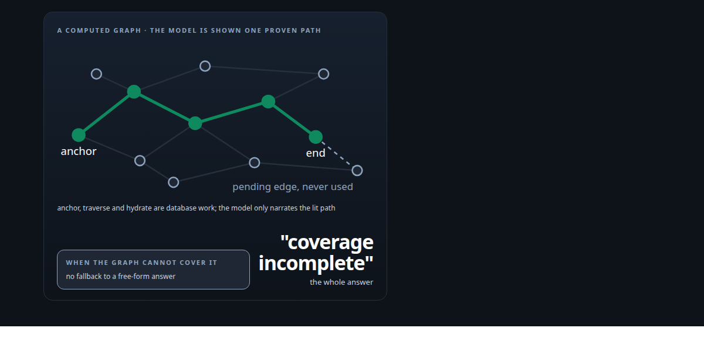
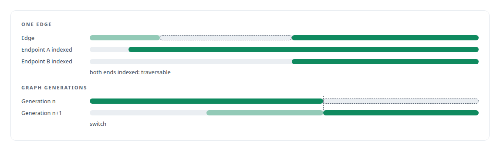
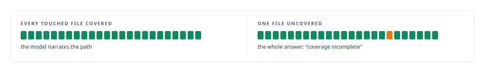

# A code explainer that is not allowed to invent

**Compute the call graph first, narrate second: putting deterministic evidence in front of the model**

Canonical: https://coreyjames.ai/stories/a-code-explainer-that-is-not-allowed-to-invent/  
Author: Corey James · Published: 2026-10-28 · Kind: story  
DOI: https://doi.org/10.5281/zenodo.23735132 (this page is a chapter of the system's report)  
Systems: [FAFOHive](https://github.com/coreyjames-ai/fafohive)  
Technologies: [Code graph and static dependency analysis](https://github.com/coreyjames-ai/portfolio/tree/main/technologies/code-graph-and-static-dependency-analysis) · [Evidence-grounded LLM output](https://github.com/coreyjames-ai/portfolio/tree/main/technologies/evidence-grounded-llm-output) · [Hugging Face Text Embeddings Inference](https://github.com/coreyjames-ai/portfolio/tree/main/technologies/hugging-face-text-embeddings-inference) · [Hybrid retrieval](https://github.com/coreyjames-ai/portfolio/tree/main/technologies/hybrid-retrieval) · [Multi-vendor LLM integration](https://github.com/coreyjames-ai/portfolio/tree/main/technologies/multi-vendor-llm-integration) · [PostgreSQL](https://github.com/coreyjames-ai/portfolio/tree/main/technologies/postgresql) · [PyO3](https://github.com/coreyjames-ai/portfolio/tree/main/technologies/pyo3) · [Redis](https://github.com/coreyjames-ai/portfolio/tree/main/technologies/redis) · [Rust](https://github.com/coreyjames-ai/portfolio/tree/main/technologies/rust) · [Text embedding models](https://github.com/coreyjames-ai/portfolio/tree/main/technologies/text-embedding-models) · [Web crawling and document extraction](https://github.com/coreyjames-ai/portfolio/tree/main/technologies/web-crawling-and-document-extraction) · [pgvector](https://github.com/coreyjames-ai/portfolio/tree/main/technologies/pgvector) · [rmcp (Rust MCP SDK)](https://github.com/coreyjames-ai/portfolio/tree/main/technologies/rmcp-rust-mcp-sdk) · [tree-sitter](https://github.com/coreyjames-ai/portfolio/tree/main/technologies/tree-sitter)  
Skills: [evidence-gated acceptance](https://github.com/coreyjames-ai/portfolio/tree/main/skills/evidence-gated-acceptance) · [AI-assisted engineering methodology](https://github.com/coreyjames-ai/portfolio/tree/main/skills/ai-assisted-engineering-methodology)  



## Result

| Figure | What it measures |
| --- | --- |
| **294,033** | of 294,362 code chunks covered by the graph |
| **0** | model calls in a dependency trace |
| **19,000** | files, several languages, in the indexed monorepo |

## What was built

Ask a language model how a piece of code works and it will tell you, fluently, including call paths that do not exist. Engineers act on those answers. I built a code-intelligence service where the model may only describe edges that a computed graph has already proven. The graph is extracted from source with a parser, dependency traces are plain database traversals with no model involved, and the explainer narrates only the evidence it is handed. If the graph's coverage is incomplete for a query, the answer is "coverage incomplete".

## The challenge

A monorepo of around 19,000 files across several languages, used daily by AI agents that must understand blast radius before changing a symbol. The service had to be fast enough for agents to call before every change, accurate enough to act on, and structurally unable to present fabricated structure.

## Constraints

Multi-language: Rust, Python, C#, TypeScript and more in one index. Routine use, so it cannot take minutes. And no fabrication, because a wrong answer with a confident tone is worse than no answer.

## My approach

Compute first, narrate second. Everything the model is allowed to say about structure is computed before the model sees the question. Symbol dependencies, callers, callees, implementations and imports come from a graph built by a parser, stored in a database, and traversed with bounded queries. The model's only job is to put a path it has been shown into plain language.

## What I built

Edge extraction with tree-sitter into partitioned edge tables, with a resolver that moves edges from pending to active as their endpoints are indexed, and graph generations so an index can be rebuilt without serving a half-built graph.



Dependency tracing as a bounded breadth-first search in SQL, with no model in the loop.

Path explanation: a deterministic anchor, a bounded traversal between two points, hydration of the code on that path, and only then narration by a model of exactly that evidence.

A coverage check that returns "coverage incomplete" when the graph does not fully cover the files a query touches.



## Difficult decisions

No fallback. When the graph cannot answer, the obvious product move is to let the model answer free-form with a caveat. I did not build that path.


## Results

Tracing the blast radius of a symbol before changing it is a standing rule in my agents' operating doctrine, and this service is how they do it.

## Technologies used

Rust · tree-sitter · PostgreSQL · Redis · Dense embeddings for semantic search · Bounded graph traversal · Model narration over supplied evidence

## What this demonstrates

Putting deterministic evidence in front of models instead of asking models for evidence. It is the same instinct that runs through my governance work, applied to the question "how does this code work".

> A refusal beats a plausible guess, because the caveat is the first thing a reader stops seeing.

## What was verified

Each line is a claim the canonical page supports, with the figure as the page states it.

- Code intelligence for AI agents: a tree-sitter call graph over a 19,000-file multi-language monorepo, with 294,033 of 294,362 code chunks covered.
- Hallucination prevention by design: the model narrates only a path the graph has proven, and a query the graph cannot fully cover returns coverage incomplete instead of a guess.
- Graph queries in SQL: dependency tracing as a bounded breadth-first search over partitioned edge tables, with 0 model calls in a trace.
- Index lifecycle design: edges move from pending to active as their endpoints are indexed, and graph generations let the index rebuild without serving a half-built graph.

## Related

- [Agents with real tools and no keys](https://github.com/coreyjames-ai/fafohive/tree/main/stories/agents-with-real-tools-and-no-keys) · https://coreyjames.ai/stories/agents-with-real-tools-and-no-keys/
- [Why long agent runs fail](https://github.com/coreyjames-ai/agentos/tree/main/stories/why-long-agent-runs-fail) · https://coreyjames.ai/stories/why-long-agent-runs-fail/

## Citation

Corey James. "A code explainer that is not allowed to invent." coreyjames.ai, 2026. https://coreyjames.ai/stories/a-code-explainer-that-is-not-allowed-to-invent/ In: the FAFOHive technical report, doi:10.5281/zenodo.23735132.

```bibtex
@misc{coreyjames-a-code-explainer-that-is-not-allowed-to-invent,
  author = {Corey James},
  title = {A code explainer that is not allowed to invent},
  year = {2026},
  howpublished = {\url{https://coreyjames.ai/stories/a-code-explainer-that-is-not-allowed-to-invent/}},
  note = {GitHub copy: https://github.com/coreyjames-ai/fafohive/tree/main/stories/a-code-explainer-that-is-not-allowed-to-invent},
  doi = {10.5281/zenodo.23735132}
}
```

Part of [FAFOHive](https://github.com/coreyjames-ai/fafohive) and [Corey James's portfolio](https://github.com/coreyjames-ai/portfolio) · site: https://coreyjames.ai/ · MCP server: https://coreyjames.ai/mcp · agent card: https://coreyjames.ai/.well-known/agent.json
