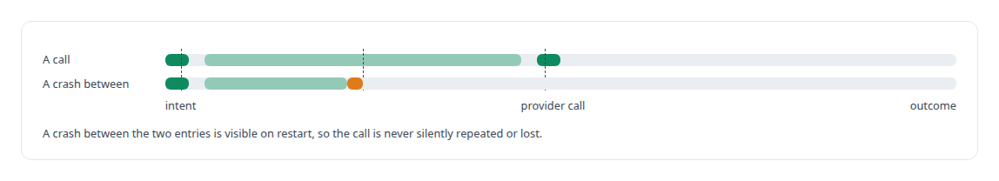
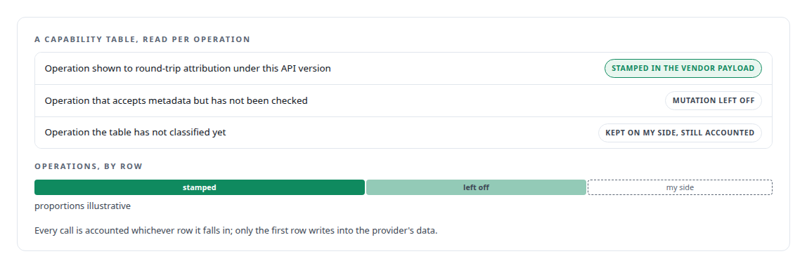
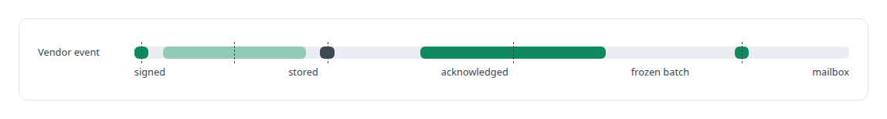

# Agents with real tools and no keys

**A governed gateway that lets AI agent teams use payments, email and social-publishing services with every action attributed and no credential in any agent**

Canonical: https://coreyjames.ai/stories/agents-with-real-tools-and-no-keys/  
Author: Corey James · Published: 2026-10-28 · Kind: story  
DOI: https://doi.org/10.5281/zenodo.23735132 (this page is a chapter of the system's report)  
Systems: [FAFOHive](https://github.com/coreyjames-ai/fafohive) · [AgentOS](https://github.com/coreyjames-ai/agentos)  
Technologies: [Business-provider APIs rebuilt as governed agent tools](https://github.com/coreyjames-ai/portfolio/tree/main/technologies/business-provider-apis-rebuilt-as-governed-agent-tools) · [Cloudflare Tunnel](https://github.com/coreyjames-ai/portfolio/tree/main/technologies/cloudflare-tunnel) · [Idempotency, exactly-once effects and crash recovery](https://github.com/coreyjames-ai/portfolio/tree/main/technologies/idempotency-exactly-once-effects-and-crash-recovery) · [Identity and access management for AI agents](https://github.com/coreyjames-ai/portfolio/tree/main/technologies/identity-and-access-management-for-ai-agents) · [JSON Web Token (JWT)](https://github.com/coreyjames-ai/portfolio/tree/main/technologies/json-web-token-jwt) · [MCP tool design](https://github.com/coreyjames-ai/portfolio/tree/main/technologies/mcp-tool-design) · [Meta Graph API](https://github.com/coreyjames-ai/portfolio/tree/main/technologies/meta-graph-api) · [Model Context Protocol (MCP)](https://github.com/coreyjames-ai/portfolio/tree/main/technologies/model-context-protocol-mcp) · [OAuth 2.0](https://github.com/coreyjames-ai/portfolio/tree/main/technologies/oauth-2-0) · [PostgreSQL](https://github.com/coreyjames-ai/portfolio/tree/main/technologies/postgresql) · [Prompt-injection-aware tooling](https://github.com/coreyjames-ai/portfolio/tree/main/technologies/prompt-injection-aware-tooling) · [Python](https://github.com/coreyjames-ai/portfolio/tree/main/technologies/python) · [Reddit](https://github.com/coreyjames-ai/portfolio/tree/main/technologies/reddit) · [Rust](https://github.com/coreyjames-ai/portfolio/tree/main/technologies/rust) · [SQLite](https://github.com/coreyjames-ai/portfolio/tree/main/technologies/sqlite) · [TypeScript](https://github.com/coreyjames-ai/portfolio/tree/main/technologies/typescript) · [Webhook ingestion and verification](https://github.com/coreyjames-ai/portfolio/tree/main/technologies/webhook-ingestion-and-verification) · [X API](https://github.com/coreyjames-ai/portfolio/tree/main/technologies/x-api)  
Skills: [exactly-once delivery and crash recovery](https://github.com/coreyjames-ai/portfolio/tree/main/skills/exactly-once-delivery-and-crash-recovery) · [tool synthesis and governed API integration](https://github.com/coreyjames-ai/portfolio/tree/main/skills/tool-synthesis-and-governed-api-integration) · [multi-agent governance](https://github.com/coreyjames-ai/portfolio/tree/main/skills/multi-agent-governance) · [distributed systems correctness](https://github.com/coreyjames-ai/portfolio/tree/main/skills/distributed-systems-correctness)  


## Result

| Figure | What it measures |
| --- | --- |
| **~350** | vendor operations visible to managed agents, each rebuilt as my own tool |
| **0** | credentials held by any agent |
| **2 hosts** | attribution and webhook delivery proven end to end |

## What was built

I wanted AI agent teams to run small experimental businesses: take payments, send email, publish to social platforms. The moment you hand an agent a vendor API key you have three problems. The key leaks into logs. You cannot say afterwards which assignment created which customer or post. And the vendor's events, a payment, a reply, a bounce, have no way back to the team that caused them. I built one governed gateway between agents and vendors that solves all three. It exposes several hundred vendor operations to managed agents, every one attributed, with no agent ever holding a key.

## The challenge

Each provider publishes an API for exactly these services. Handing an agent a client for it is easy and wrong: a raw key in an agent's context is a key in a transcript, and a crash between "called the provider" and "wrote down that I did" either double-charges a customer or loses track of a charge. Several businesses had to run at once, isolated from one another, with a human keeping authority over launch, money and concept.

## Constraints

Three provider APIs with hundreds of operations between them, only some of which accept the metadata attribution needs. Crash safety across a network boundary. Isolation, so agents for one business cannot act for another. And human authority over financial actions and launches.

## My approach

One gateway, and identity from the caller. The gateway knows which governed assignment an agent is working under because the agent authenticated as that assignment, so no tool argument can claim to be someone else. Attribution is written into a vendor payload only where that exact operation, under that exact API version, has been shown to round-trip it; everywhere else attribution is kept on my side. Each business is one long-running governed work order with its own repository, subdomain, provider namespace and mailbox.

## What I built

Every provider operation rebuilt from the provider's API as a tool contract of my own, under stable namespaces, so agents see one steady surface across providers.

Durable accounting around every call, so a restart does not repeat a provider call.



Per-provider capability tables listing which operations round-trip attribution and which do not.



Returned-object extraction, so the customer, price or post a vendor created is captured and tied to the assignment that created it.

A signed, durable webhook return path that delivers the vendor's events, in frozen batches, to the mailbox of the team lead whose assignment caused them.



Three binding tools for agents that derive their assignment identity on the server side, so an agent cannot bind a website or mailbox for a business that is not its own.

A public site with provenance-tracked generated media and a readiness checklist.

## Difficult decisions

Leaving a mutation disabled. The email and customer-relationship provider accepts metadata on some operations. Until I had checked which ones round-tripped it correctly, the gateway left that mutation off.


Leaving an unclassified operation unattributed. When a provider adds an operation the capability table has not classified, the tool still works and the call is still accounted, and attribution waits until that operation's contract has been checked.

Replacing the first version. The initial design put shared key files on agent seats. It worked and it was wrong. The second version holds credentials server-side only.

Keeping the money with a human. Financial authority stays with me.

## Results

Attribution and webhook delivery were proven end to end on two hosts, with no credential on any agent seat.

## Technologies used

Rust · Model Context Protocol · OAuth 2.0 and JWT identity · PostgreSQL · Webhook signature verification · TypeScript · Tunnelled ingress · AgentOS governance

## What this demonstrates

Security-first integration architecture. I remove the confused-deputy problem by design, keep accounting that a restart cannot duplicate across a network boundary, and own both the tools, rebuilt from each provider's API, and the governance layer that makes it safe for agents to use.

> Attribution that might be silently dropped is worse than none.

## What was verified

Each line is a claim the canonical page supports, with the figure as the page states it.

- Governed API integration for AI agents: one gateway exposing ~350 vendor operations, each rebuilt from the provider's API as my own tool, with 0 credentials held by any agent.
- Identity architecture for AI agents: identity derived from the authenticated assignment, never from tool arguments, so an agent cannot act or bind a website for another business.
- Exactly-once delivery and crash recovery: durable accounting around every provider call, so a restart never repeats a charge or loses track of one.
- Data attribution and provenance: attribution stamped into a vendor payload only where that operation and API version round-trips it, otherwise kept on my side; proven end to end on 2 hosts.
- Webhook ingestion and routing: signed vendor events returned in frozen batches to the mailbox of the team lead whose assignment caused them.

## Related

- [Why long agent runs fail](https://github.com/coreyjames-ai/agentos/tree/main/stories/why-long-agent-runs-fail) · https://coreyjames.ai/stories/why-long-agent-runs-fail/
- [A code explainer that is not allowed to invent](https://github.com/coreyjames-ai/fafohive/tree/main/stories/a-code-explainer-that-is-not-allowed-to-invent) · https://coreyjames.ai/stories/a-code-explainer-that-is-not-allowed-to-invent/

## Citation

Corey James. "Agents with real tools and no keys." coreyjames.ai, 2026. https://coreyjames.ai/stories/agents-with-real-tools-and-no-keys/ In: the FAFOHive technical report, doi:10.5281/zenodo.23735132.

```bibtex
@misc{coreyjames-agents-with-real-tools-and-no-keys,
  author = {Corey James},
  title = {Agents with real tools and no keys},
  year = {2026},
  howpublished = {\url{https://coreyjames.ai/stories/agents-with-real-tools-and-no-keys/}},
  note = {GitHub copy: https://github.com/coreyjames-ai/fafohive/tree/main/stories/agents-with-real-tools-and-no-keys},
  doi = {10.5281/zenodo.23735132}
}
```

Part of [FAFOHive](https://github.com/coreyjames-ai/fafohive) and [Corey James's portfolio](https://github.com/coreyjames-ai/portfolio) · site: https://coreyjames.ai/ · MCP server: https://coreyjames.ai/mcp · agent card: https://coreyjames.ai/.well-known/agent.json
