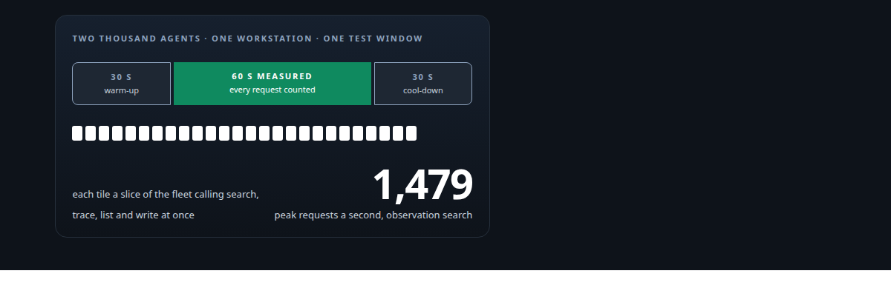
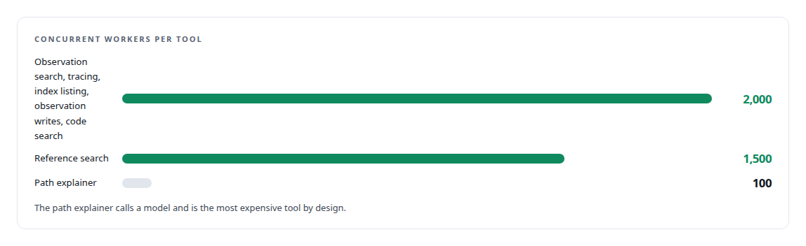
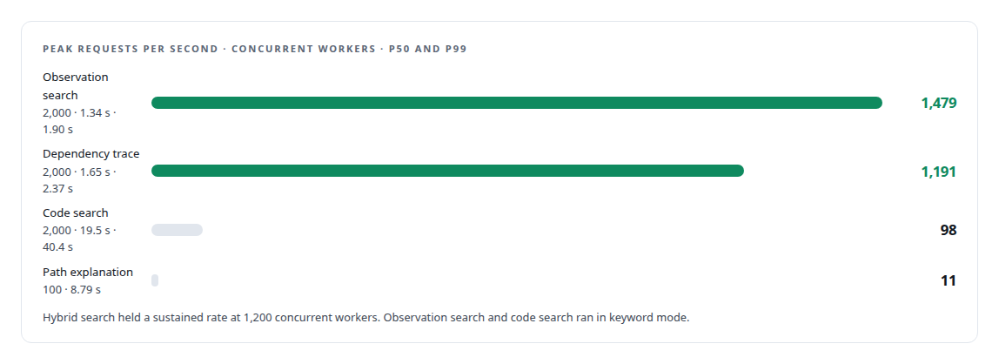

# Two thousand concurrent workers

**Load-testing the memory and code-intelligence service with a fleet of AI agents on one workstation, with zero failures**

Canonical: https://coreyjames.ai/stories/two-thousand-concurrent-workers/  
Author: Corey James · Published: 2026-10-28 · Kind: story  
Systems: [FAFOHive](https://github.com/coreyjames-ai/fafohive)  
Technologies: [Capacity engineering, backpressure and load testing](https://github.com/coreyjames-ai/portfolio/tree/main/technologies/capacity-engineering-backpressure-and-load-testing) · [Code graph and static dependency analysis](https://github.com/coreyjames-ai/portfolio/tree/main/technologies/code-graph-and-static-dependency-analysis) · [Hybrid retrieval](https://github.com/coreyjames-ai/portfolio/tree/main/technologies/hybrid-retrieval) · [PostgreSQL](https://github.com/coreyjames-ai/portfolio/tree/main/technologies/postgresql) · [Rust](https://github.com/coreyjames-ai/portfolio/tree/main/technologies/rust)  
Skills: [AI-assisted engineering methodology](https://github.com/coreyjames-ai/portfolio/tree/main/skills/ai-assisted-engineering-methodology) · [inference serving architecture](https://github.com/coreyjames-ai/portfolio/tree/main/skills/inference-serving-architecture) · [Rust systems engineering](https://github.com/coreyjames-ai/portfolio/tree/main/skills/rust-systems-engineering) · [distributed systems correctness](https://github.com/coreyjames-ai/portfolio/tree/main/skills/distributed-systems-correctness)  



## Result

| Figure | What it measures |
| --- | --- |
| **2,000** | concurrent AI workers on the retrieval tools at once |
| **0** | failures across the run |
| **1,479** | requests a second held in keyword mode, from a floor of 1,271 |

## What was built

Every agent in my estate asks the memory service before it acts: what did we decide, what calls this symbol, how does this path work. If that service stalls under a fleet, every agent stalls with it. So I load-tested it the way the fleet uses it: two thousand concurrent AI workers hammering the retrieval tools at once, on a single workstation. Nothing failed.

## The fixture

One workstation: a 24-core Intel Core Ultra with 256 GB of DDR5 and a consumer Blackwell GPU that was not used to accelerate retrieval. The service is Rust over PostgreSQL.



## The numbers



Semantic search ran at about 1.2 seconds median across a working codebase.


## Why it held

Every endpoint is bounded. The reranker saturates rather than errors under load. Observation writes go through a dedicated connection pool so that capturing what an agent did never competes with answering what it asked. The caching layer answers repeat questions in under 100 milliseconds, and in a fleet most questions repeat. The code graph itself is precomputed, so a dependency trace is a bounded traversal rather than a model call.

## What this demonstrates

Capacity engineering for the workload I actually run: a fleet of agents, not a handful of users. The service was designed with backpressure in every path and then tested against the fleet it serves, with the weak row published next to the strong ones.

> The slow row is honest: code search over a large index at two thousand concurrent callers is bound by the database, and the numbers say so.

## What was verified

Each line is a claim the canonical page supports, with the figure as the page states it.

- Load testing with AI agent fleets: 2,000 concurrent AI workers on a memory and code-intelligence service on one workstation, with 0 failures.
- Capacity engineering and backpressure: every endpoint bounded, a reranker that saturates instead of erroring, and a dedicated pool so observation writes never compete with reads.
- Retrieval service performance: 1,479 requests a second held in keyword mode from a floor of 1,271; repeat questions answered from cache in under 100 milliseconds.
- Rust and PostgreSQL service design: a precomputed code graph, so a dependency trace under load is a bounded traversal rather than a model call.

## Related

- [A code explainer that is not allowed to invent](https://github.com/coreyjames-ai/fafohive/tree/main/stories/a-code-explainer-that-is-not-allowed-to-invent) · https://coreyjames.ai/stories/a-code-explainer-that-is-not-allowed-to-invent/
- [What the work cost, to the penny](https://github.com/coreyjames-ai/agentos/tree/main/stories/what-the-work-cost) · https://coreyjames.ai/stories/what-the-work-cost/

## Citation

Corey James. "Two thousand concurrent workers." coreyjames.ai, 2026. https://coreyjames.ai/stories/two-thousand-concurrent-workers/

```bibtex
@misc{coreyjames-two-thousand-concurrent-workers,
  author = {Corey James},
  title = {Two thousand concurrent workers},
  year = {2026},
  howpublished = {\url{https://coreyjames.ai/stories/two-thousand-concurrent-workers/}},
  note = {GitHub copy: https://github.com/coreyjames-ai/fafohive/tree/main/stories/two-thousand-concurrent-workers}
}
```

Part of [FAFOHive](https://github.com/coreyjames-ai/fafohive) and [Corey James's portfolio](https://github.com/coreyjames-ai/portfolio) · site: https://coreyjames.ai/ · MCP server: https://coreyjames.ai/mcp · agent card: https://coreyjames.ai/.well-known/agent.json
